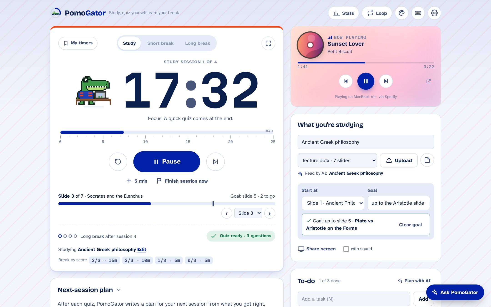
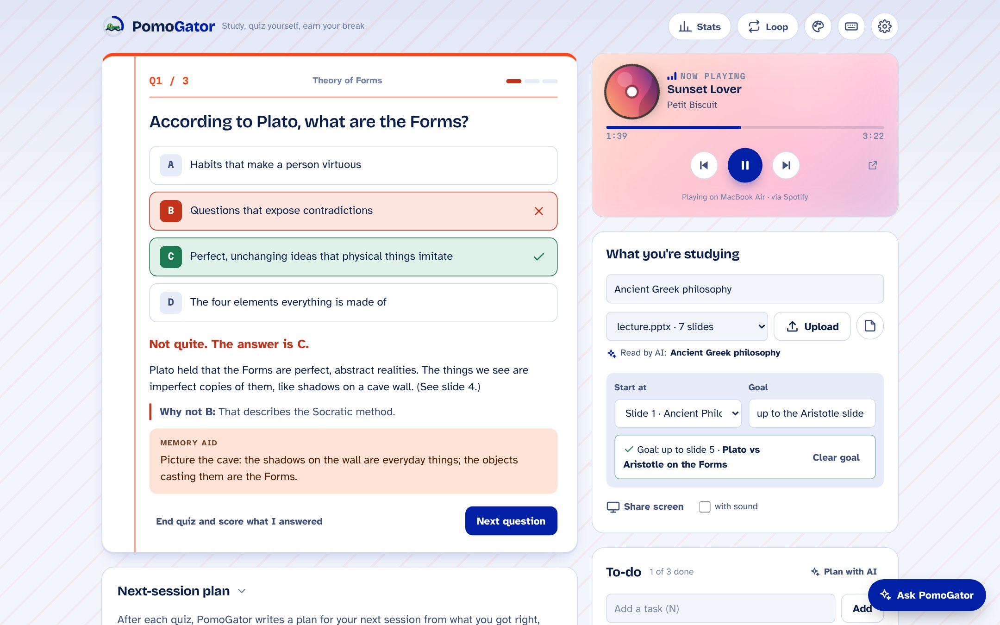
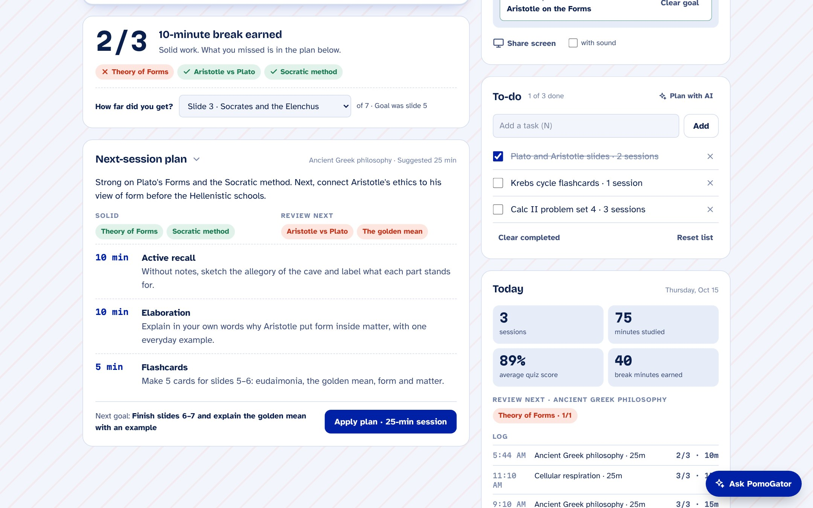
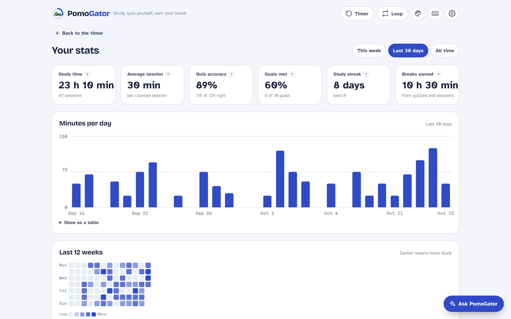
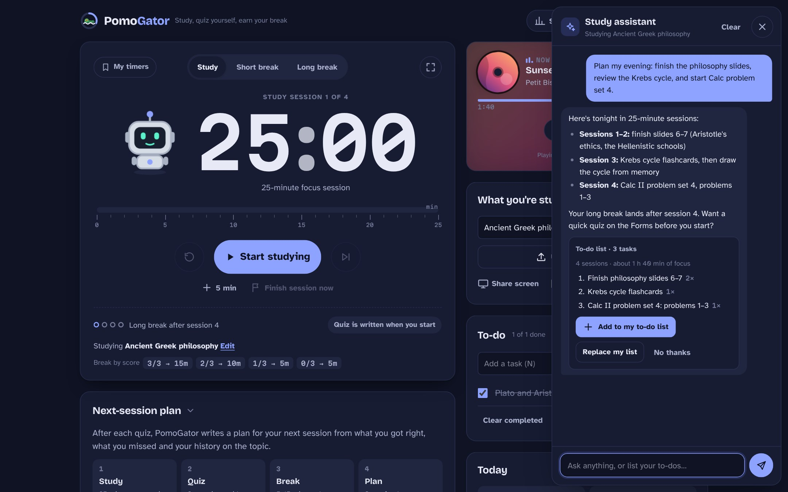
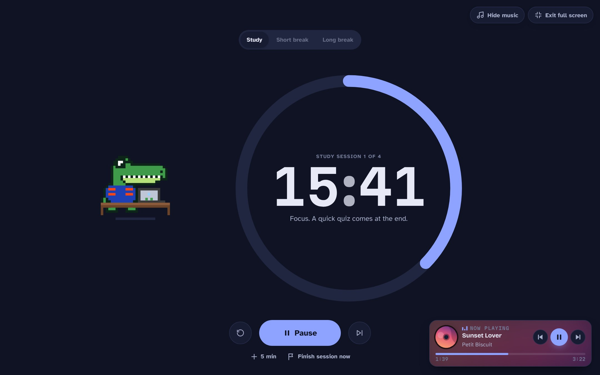
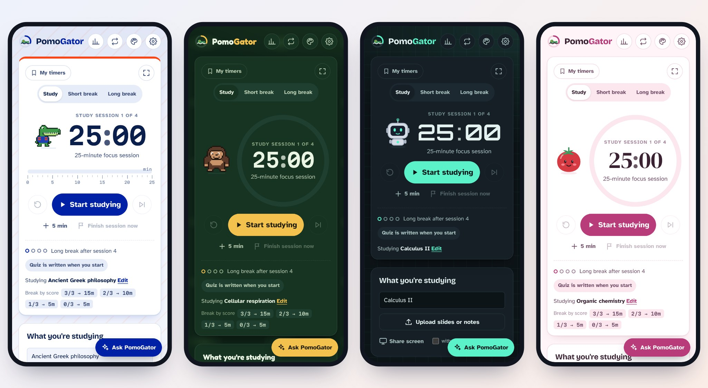
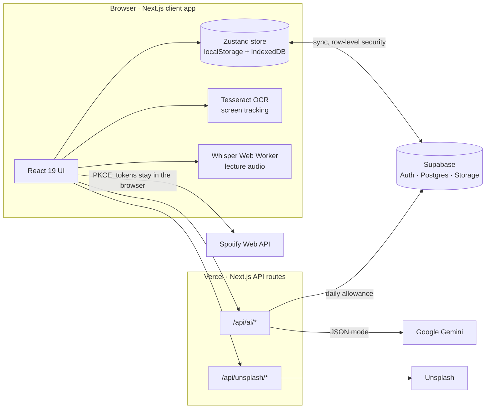

<div align="center">


# PomoGator

**Study, quiz yourself, earn your break.**

A Pomodoro timer that writes a quick quiz on what you just studied. Your score sets your break,
and an AI-written plan sets up your next session.

[**Try it live →**](https://studybuddy-bay.vercel.app) &nbsp;·&nbsp; [How it's built](#how-its-built) &nbsp;·&nbsp; [Architecture](docs/ARCHITECTURE.md) &nbsp;·&nbsp; [Run your own](docs/SETUP.md)

[](https://github.com/abdulksidani-png/studybuddy/actions/workflows/ci.yml)




</div>

## Why

Most Pomodoro apps only count minutes. PomoGator closes the loop with **retrieval practice**, one of the
best-supported study techniques: every session ends with 1–3 questions on what you actually covered, every answer
comes with an explanation and a memory aid, and **your score earns your break** (3/3 → 15 min, 2/3 → 10 min,
1/3 or 0/3 → 5 min). After the quiz, a plan for the next session targets exactly what you missed.

## Features

- **The study loop.** 25–45 minute sessions, a quiz at the end, a break set by your score, a long break every
  fourth session, and a next-session plan built from your mistakes and your history on the topic.
- **Your own material.** Upload a PDF, PowerPoint, Word file, text or photos of notes, then set a goal in plain words
  ("up to the Aristotle slide"). The AI reads every upload in the background (topic, summary, key concepts), and
  quizzes come only from the pages you covered.
- **Follows along, privately.** Optional screen tracking works out which slide you're on by reading your slides window
  with on-device OCR. Optional lecture-tab audio is transcribed on-device by a small Whisper model, so the quiz can
  cover what the lecturer said.
- **An AI study assistant.** A chat panel that sees your timer, to-do list and documents, answers questions, quizzes
  you, and turns "here's everything I need to do tonight" into a to-do list sized in Pomodoro sessions.
- **Stats.** Study time, streaks (with streak freezes), minutes per day, a 12-week heatmap, quiz accuracy by concept,
  and slide-by-slide coverage of each document.
- **Make it yours.** 12 themes, 5 study buddies that put on glasses and study at a desk while you do (including Albert,
  a pixel-art gator), 7 clock fonts, 3 timer styles, Unsplash photo backgrounds, glass cards, saved timer presets,
  a full-screen focus mode and a Spotify "now playing" widget.
- **Accounts without friction.** Start instantly as a guest; sign in with Google or an email link later and keep
  everything. Progress syncs across devices.

## Screenshots

| | |
| --- | --- |
|  |  |
| **Quiz feedback.** The right answer, why yours was wrong, and a memory aid. | **Score → break → plan.** What you missed becomes the next session. |
|  |  |
| **Stats.** Totals, streaks, minutes per day and a 12-week heatmap. | **Study assistant.** Plans your evening in Pomodoro sessions. |
|  |  |
| **Focus mode.** Full screen, with the music player in the corner. | **Themes and buddies,** on any screen size. |

## How it's built

- **A timer that can't drift.** The timer stores an end timestamp, not a countdown, so it stays exact across
  refreshes, sleeping laptops and background tabs.
- **Local-first sync.** Everything lives in a [Zustand](https://zustand.docs.pmnd.rs) store on the device first.
  Signed-in data syncs to Supabase as versioned slices (newest wins, with version numbers that only go up, so a
  device with a fast clock can't overwrite newer edits) plus history merged by id. Guests are anonymous Supabase
  users who are upgraded in place when they sign in, so nothing has to move.
- **AI with guardrails.** Gemini runs in JSON mode behind this site's own API routes. Every reply is validated and
  normalized on the server and again in the browser; a malformed reply gets one retry; a rate-limited model falls
  back to a lighter one; a per-person daily allowance is enforced in Postgres; and if the AI is unavailable you
  simply get a no-quiz break.
- **On-device machine learning.** Screen tracking runs Tesseract.js OCR on changed frames only and matches the text
  to slides with IDF-weighted word overlap. Lecture audio is cut into clips by an AudioWorklet and transcribed by
  Whisper (Transformers.js) in a Web Worker. Frames and audio never leave the device.
- **Documents parsed in the browser** with pdf.js, PowerPoint slide XML (JSZip) and mammoth for Word.
- **Security by default.** Row-level security on every table and a private, per-user file bucket; API keys stay on
  the server; Google's raw error text never reaches the browser; standard hardening headers. See
  [Privacy](https://studybuddy-bay.vercel.app/privacy).
- **Accessible.** Full keyboard control (press `?` in the app), screen-reader labels and live regions, focus
  management through the quiz, and reduced-motion support.

More detail, including the data model and sync rules, is in [docs/ARCHITECTURE.md](docs/ARCHITECTURE.md).



## Tech stack

| Area | Tools |
| --- | --- |
| App | Next.js 15 (App Router), React 19, TypeScript (strict), Tailwind CSS 4 plus hand-written CSS, Motion |
| State and storage | Zustand with persist and Immer, localStorage, IndexedDB |
| Backend | Supabase (Auth, Postgres with row-level security, Storage), Vercel |
| AI | Google Gemini API (JSON mode), Tesseract.js, Whisper via Transformers.js |
| Documents | pdf.js, JSZip, mammoth |
| Integrations | Unsplash API, Spotify Web API (PKCE) |
| Testing | Vitest, Playwright, PostgreSQL + PostgREST for sync tests, GitHub Actions |

## Run it yourself

```bash
git clone https://github.com/abdulksidani-png/studybuddy.git pomogator
cd pomogator
npm install
npm run dev        # http://localhost:3000
```

It runs with no keys at all, saving everything in the browser. To switch on accounts, AI, photos and music, copy
`.env.example` to `.env.local` and follow **[docs/SETUP.md](docs/SETUP.md)** (free tiers only).

## Tests

```bash
npm run typecheck
npm test            # 79 unit tests: break rules, AI reply validation, stats (time zones, 4 AM rollover, streak freezes), sync merging, saved timers
npm run test:e2e    # 21 browser tests: study → quiz → break, document goals, screen tracking, tab audio, appearance, stats, focus mode
npm run test:ai     # 6 browser tests of the AI, Unsplash and Spotify features against local stand-ins
npm run test:sync   # two devices syncing through real Postgres + PostgREST running the actual migrations
```

GitHub Actions runs the typecheck, unit tests, build and both browser suites on every push.
`tests/db/rls-check.sql` checks that no account can read or change another account's rows.

## Project layout

```
app/                  routes: the app, /stats, /privacy, sign-in callbacks, and /api (AI, photos, config)
components/           UI: timer and quiz (Stage), panels, documents, stats, assistant, music, study buddies
lib/                  state (store), sync, stats engine, breaks, AI client and prompts, appearance, saved timers
lib/docs/             parsing, OCR, screen tracking, lecture audio, goal and slide matching
supabase/migrations/  database schema and row-level security policies
tests/                unit, browser, AI and sync suites, plus stand-ins for Gemini and Supabase
docs/                 setup guide, architecture notes, the original spec and prototype, screenshots
```

## Roadmap

- Weekly report: a recap of the week's study time, quiz accuracy and weak spots.
- Check-in streaks and celebrations.
- Export your data and delete your account in one click.

## Credits

Photos come from [Unsplash](https://unsplash.com) and their photographers are credited in the app. Music data comes
from Spotify. Fonts are bundled from [Fontsource](https://fontsource.org). Built with
[Claude Code](https://claude.com/claude-code) as an AI pair programmer.

PomoGator is a student project and is not affiliated with or endorsed by the University of Florida. The study buddies
are original art.

## License

[MIT](LICENSE)
