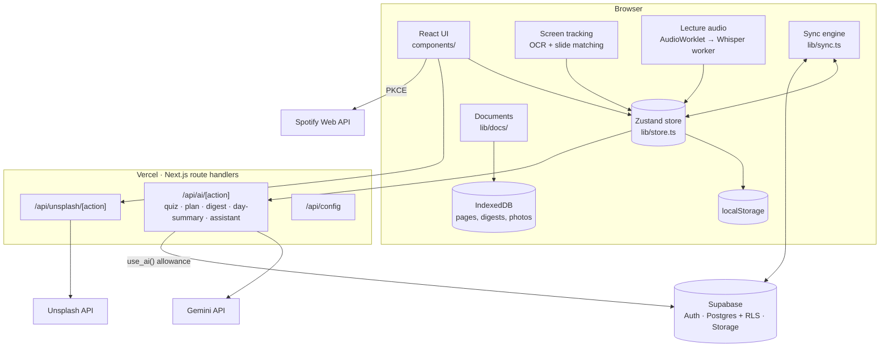

# PomoGator architecture

PomoGator is a client-first Next.js app. The whole study experience runs in the browser from a local store, so it is
instant and works offline; a few small server routes hold the API keys, and Supabase adds accounts and sync.



## The timer and the study loop

- `lib/store.ts` holds all state and actions (Zustand with `persist` and Immer). The timer stores `endAt`, an absolute
  timestamp; the time left is always `endAt - now`, so refreshes, sleeping laptops and throttled background tabs can't
  make it drift. One 250 ms ticker drives the clock and phase changes.
- A study session ends in the quiz; `lib/breaks.ts` turns the score into a break length using the tiers in settings, and
  every fourth counted session earns a long break. "Finish session now" always goes to the quiz; skipping doesn't.
- The quiz is written ahead of time: when a session starts, the store asks for it, and a `ctxKey` (topic, settings) plus
  `sourcesKey` (pages covered, transcript size) decide whether it must be rewritten near the end because the material
  changed. After the quiz, a plan is requested from the answers plus each concept's history (`ConceptStat`).

## AI pipeline

```
browser (lib/ai-client.ts) → POST /api/ai/{action} → sign-in + daily allowance (lib/ai/quota.ts)
  → prompt (lib/ai/prompts.ts) → Gemini JSON mode (lib/ai/gemini.ts) → validate (lib/quiz.ts) → browser validates again
```

- **Prompts** are pure functions with unit tests. Document text is sent with page numbers (`[Slide 4] Title`), capped
  in size, and only for the pages actually covered; the quiz asks for a page citation in every explanation.
- **Reliability:** one retry on malformed JSON; automatic fallback from `gemini-flash-latest` to
  `gemini-flash-lite-latest` on 429/404; abortable requests; every reply normalized by `cleanQuiz`, `cleanPlan`,
  `cleanDigest` and `cleanAssistant` (clamping counts, page ranges and lengths). Errors are mapped to a small set of
  codes, and only the code reaches the browser.
- **Allowance:** `use_ai()` is a `security definer` Postgres function that counts calls per user per day in
  `ai_usage`; guests get fewer calls than signed-in accounts.
- **Background reading:** each upload is "digested" once (topic, summary, key concepts, sections), stored in IndexedDB,
  and fed to quizzes and to the assistant's view of your library.

## Weekly report

- `lib/weekly.ts` is pure and unit-tested: `weekReport()` builds one week (the profile's week start, Monday by default)
  from `computeStats`, so it always agrees with the Stats page, plus last week for the ▲/▼ comparisons, pages covered,
  concepts missed and newly mastered, and three focus steps worked out from the numbers. A week's streak is the run it
  reached as of its last study day.
- The AI writes the headline, a 2–3 sentence summary and sharper focus steps (`/api/ai/weekly`) from a compact summary of
  the numbers. It's written once per week and kept with the account's synced app state (no extra table), and the in-progress
  week offers "Update" when its numbers change. Without AI, `plainSummary()` writes it from the numbers.
- The first visit of a new week shows "Your week in review" on the timer page. Weeks can be browsed at `/weekly?week=…`,
  saved as a 1080×1350 image drawn on a canvas (`lib/share-card.ts`), or printed to PDF with print styles.

## Documents, goals and screen tracking

- `lib/docs/parse.ts` turns PDF (pdf.js), PowerPoint (slide XML via JSZip), Word (mammoth), text and photos (Tesseract
  OCR) into pages with titles. The pdf.js worker and the OCR engine are copied into `public/vendor` at build time, so the
  site serves them itself.
- `lib/docs/match.ts` maps plain-language goals ("up to the Aristotle slide", "slide 12", "to the end") to a page,
  searching from the resume point, and matches screen text to slides with IDF-weighted word overlap, a title bonus and
  visible slide counters ("4 / 20").
- `lib/docs/screen.ts` uses the screen-share API only while a study session runs, skips frames that haven't changed,
  reads text on the device, and keeps only page, title and confidence.
- `lib/docs/listen.ts` taps the shared tab's audio with an AudioWorklet, cuts 12-second clips (skipping silence), and
  `public/asr-worker.js` transcribes them with Whisper tiny.en (Transformers.js) in a Web Worker.

## Accounts and sync

- Visitors become anonymous Supabase users ("guests"). Signing in with Google uses `linkIdentity`, and email uses
  `updateUser`, on the same user, so a guest's data never has to move. If the login already belongs to another account,
  the guest's data is merged into it.
- `lib/sync.ts` mirrors the local store:
  - **Slices** (settings, the study panel, in-progress timer and quiz state, tasks) carry version numbers. The newest
    version wins, and versions only ever go up (`next(k)`), so a device whose clock runs fast can't make other devices'
    edits look old.
  - **History** (sessions, quiz attempts, plans, progress events) merges by id, so two devices that both studied keep
    everything.
  - Documents sync their pages to `documents` / `document_pages`; original files go to a private Storage bucket.
- Every table uses row-level security (`user_id = (select auth.uid())`), and Storage policies restrict each user to
  their own folder. `tests/db/rls-check.sql` checks it.

## Appearance and brand

Look settings (theme, accent, clock font, timer style, background, cards, corners, spacing, study buddy) are applied
as `data-*` attributes and CSS variables on `<html>` (`lib/appearance.ts`), with the styles in `app/globals.css`. The
clock is sized with container query units so "00:00" always fits its card, its ring or the full-screen view, whatever
the font. Saved timers (`lib/presets.ts`) snapshot a chosen set of these settings plus the session lengths.

The logo is pixel art in the same 2-bit style as the study buddies, stored as rows of letters in `lib/logo.ts`
(`scripts/icon.mts` writes `app/icon.svg` from it). The loading screen (`components/Splash.tsx`) is part of the first
HTML: the logo's ring fills pixel by pixel until the app mounts and sets `data-ready`, then CSS fades it out. An inline
script in `app/layout.tsx` applies the saved theme before the first paint, so the loading screen already matches it.

## Testing

| Suite | What it covers |
| --- | --- |
| `npm test` (Vitest) | Break rules, quiz/plan/digest validation, prompts, Gemini error mapping and fallback, stats (time zones, 4 AM day rollover, streak freezes), sync merging, goal and slide matching, saved timers |
| `npm run test:e2e` (Playwright) | The full study → quiz → break loop with a fake clock, documents and goals, screen tracking with a synthetic shared screen, tab audio with a stand-in speech model, appearance, study buddies, stats, saved timers, focus mode |
| `npm run test:ai` | The real `/api/ai/*` routes against `tests/fake-gemini/server.mjs` (which also stands in for Unsplash); Spotify faked in the browser |
| `npm run test:sync` | Two browsers syncing through PostgREST on a real Postgres running the actual migrations, with a fake auth server (`tests/fake-supabase/server.mjs`) |
